<div align="center">

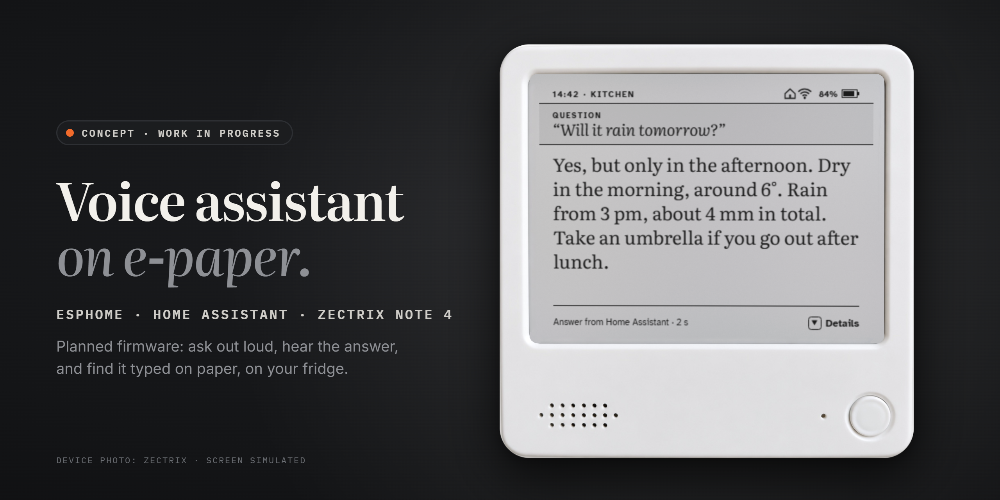

# ESPHome Voice Assistant for the Zectrix Note 4

**Ask out loud. Hear the answer. Find it typed on paper, on your fridge.**

A Home Assistant voice satellite for the Zectrix Note 4 e-paper device:<br>
an on-device wake word, the full Assist pipeline, and a page of the day that stays on the screen without power.

[](https://github.com/MichalZaniewicz/esphome-zectrix-note4-va/actions)
[](#roadmap)
[](https://esphome.io)
[](https://www.home-assistant.io/voice_control/)
[](#eight-skins)
[](#six-languages)
[](LICENSE)

[**Video**](#concept-video) · [**How it works**](#how-it-works) · [**Skins**](#eight-skins) · [**Languages**](#six-languages) · [**Blueprints**](#home-assistant-blueprints) · [**Quick start**](#quick-start) · [**Roadmap**](#roadmap)

</div>

> [!WARNING]
> **Concept phase.** The device has not arrived yet: nothing here has run on a
> Note 4. The firmware compiles in CI (ESPHome 2026.10.2, all eight skins, all
> six languages), and that is all that is proven. Every screen on this page is a
> simulation rendered from the same designs the firmware draws. Follow along,
> but do not flash it expecting a working assistant.

> [!TIP]
> ⭐ **Like where this is going?** A star is real motivation to keep it going.
>
> ☕ Want to say thanks another way? You can [buy me a coffee](https://buymeacoffee.com/zanula).

<!-- The badges live OUTSIDE the alert on purpose: Home Assistant rewrites a
GitHub alert into <ha-alert> and drops every child whose textContent is empty,
which silently removes any  placed inside it. -->

<div align="center">

[](https://github.com/MichalZaniewicz/esphome-zectrix-note4-va) [](https://buymeacoffee.com/zanula)

</div>

## Concept video

<!-- VIDEO: drag note4-concept-github.mp4 into this README in the GitHub web
editor and paste the user-attachments URL it gives on its own line here. -->

<div align="center">

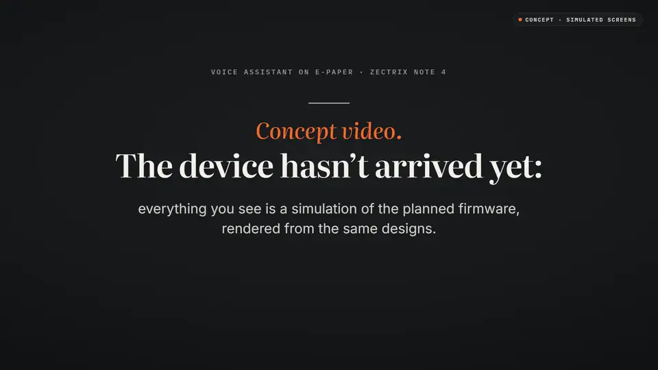

<sub>The full video runs 94 seconds, with voice-over and subtitles. A concept: the screens are simulated from the firmware's designs.</sub>

</div>

## How it works

<div align="center">
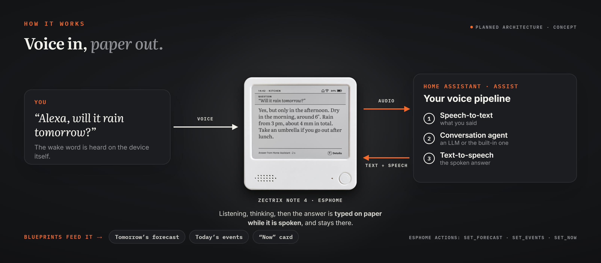
</div>

The wake word runs on the device. Your question goes to the Home Assistant Assist
pipeline you already use (speech-to-text, a conversation agent or an LLM,
text-to-speech). While the reply is spoken, the e-paper types it out word by word
with fast partial refreshes, then settles with one full refresh, and the answer
stays on the screen until you need it again. The rest of the time the device
shows a **page of the day** that Home Assistant keeps current through three
blueprints.

## See it in motion

<table>
<tr>
<td width="50%" align="center"><br><b>A conversation</b><br><sub>"Alexa" → live waveform → what it heard and each Assist step → the answer typed while it is spoken.</sub></td>
<td width="50%" align="center">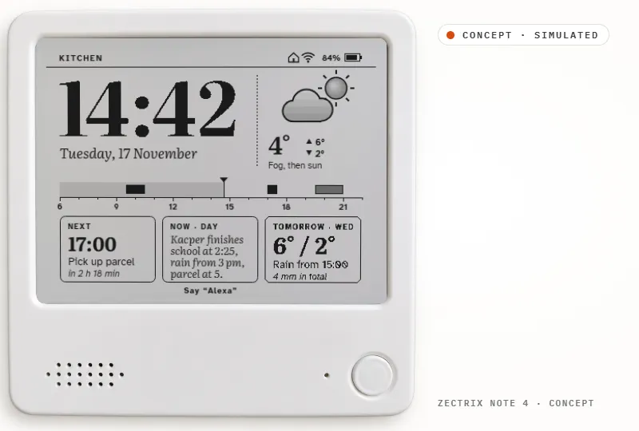<br><b>The "Now" card</b><br><sub>One thing that matters right now: a day brief, a window left open, or an alarm drawn in negative.</sub></td>
</tr>
</table>

<table>
<tr>
<td width="25%" align="center">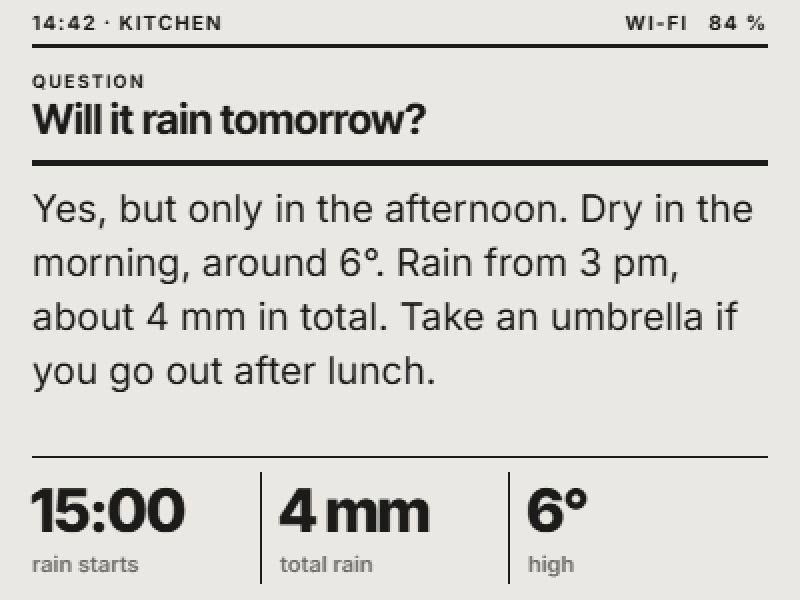<br><sub><b>Answer</b>, stays on paper</sub></td>
<td width="25%" align="center">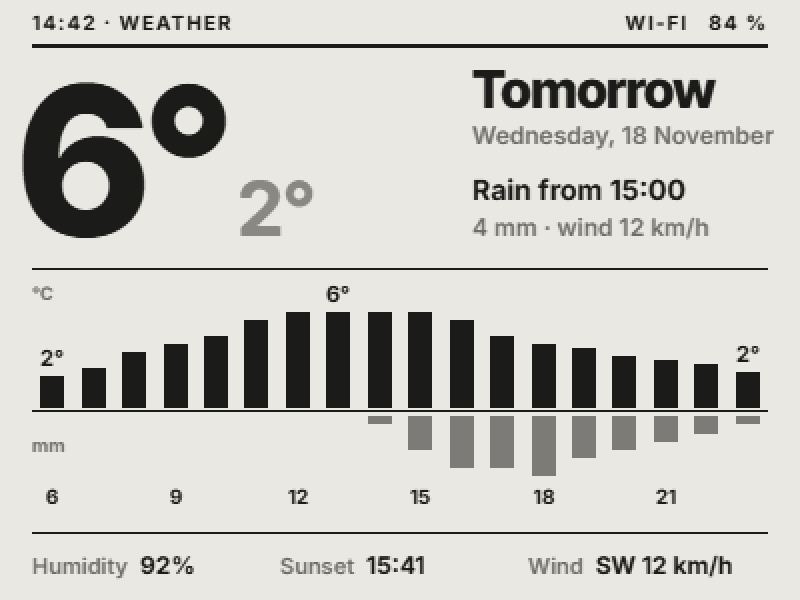<br><sub><b>Tomorrow</b>, hour by hour</sub></td>
<td width="25%" align="center">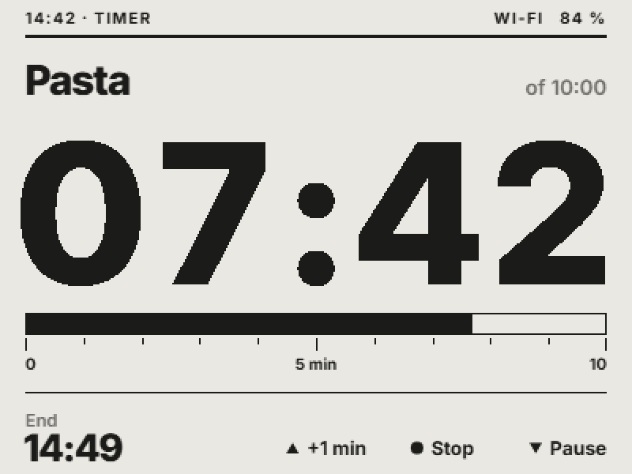<br><sub><b>Timer</b>, set by voice</sub></td>
<td width="25%" align="center">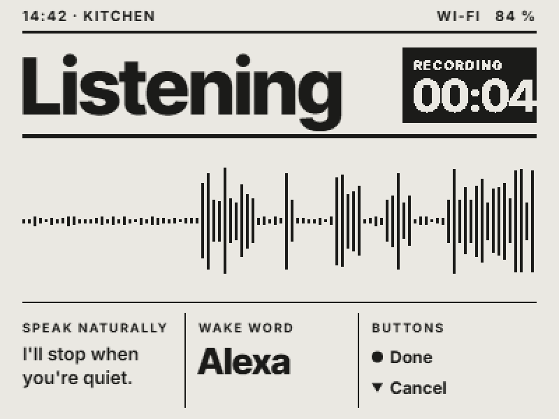<br><sub><b>Listening</b>, a live waveform</sub></td>
</tr>
</table>

## Eight skins

One firmware, eight looks. Pick one with `skin:` in your config, or switch live
with the **Skin** select in Home Assistant.

<div align="center">
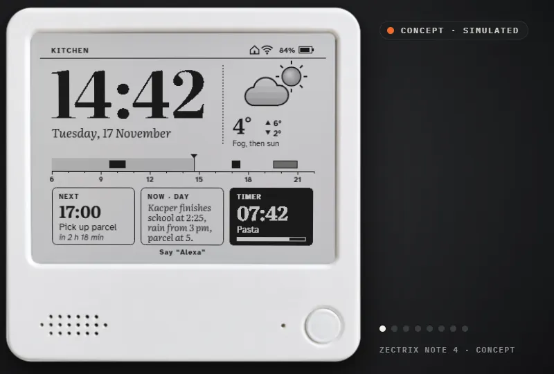
</div>

<table>
<tr>
<td width="25%" align="center">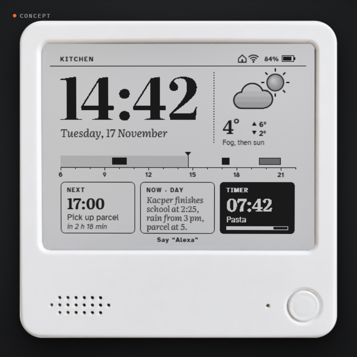<br><b><code>paper</code></b><br><sub>Serif, editorial, a notebook on the fridge.</sub></td>
<td width="25%" align="center">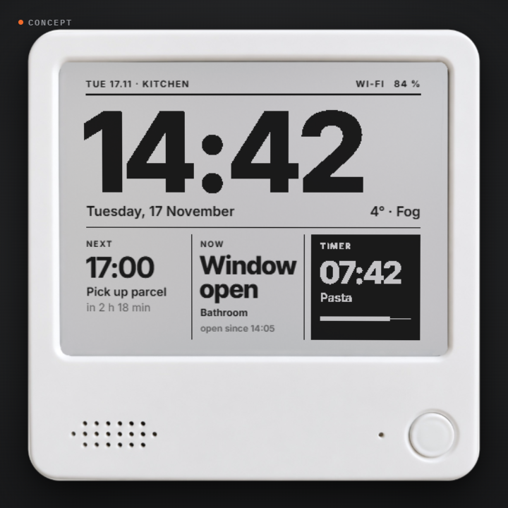<br><b><code>swiss</code></b><br><sub>Strict grid, huge numerals, one black block.</sub></td>
<td width="25%" align="center">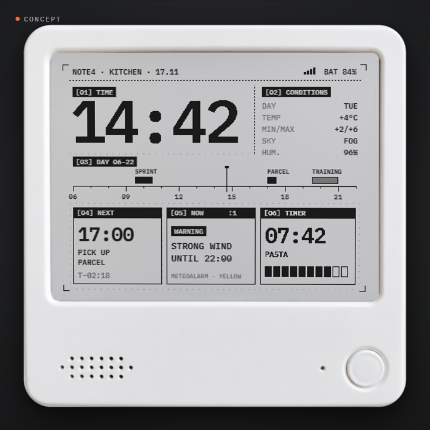<br><b><code>instrument</code></b><br><sub>Monospace, numbered fields, a lab instrument.</sub></td>
<td width="25%" align="center">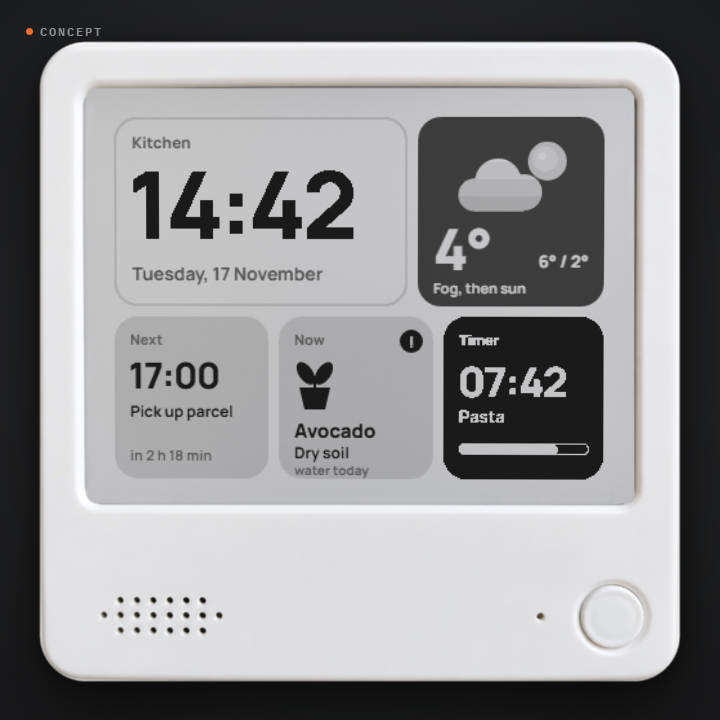<br><b><code>tiles</code></b><br><sub>Rounded tiles in greys, friendly widgets.</sub></td>
</tr>
<tr>
<td width="25%" align="center">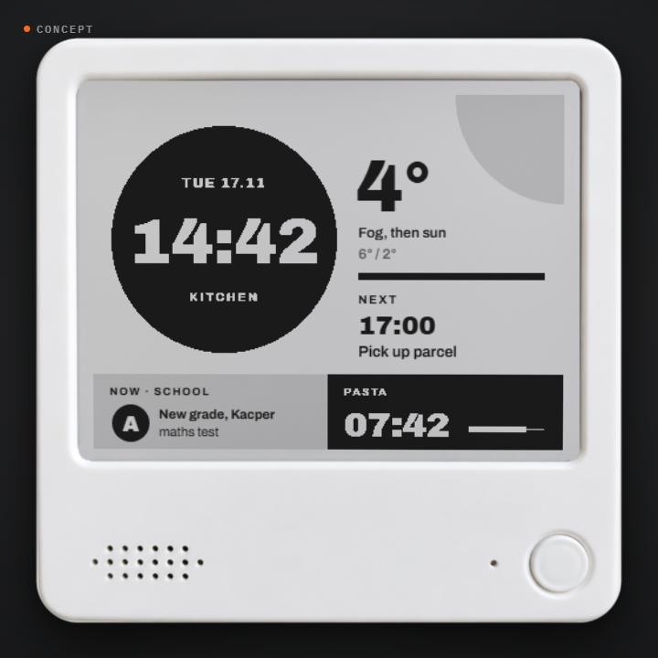<br><b><code>poster</code></b><br><sub>Bold geometry, the clock in a black circle.</sub></td>
<td width="25%" align="center">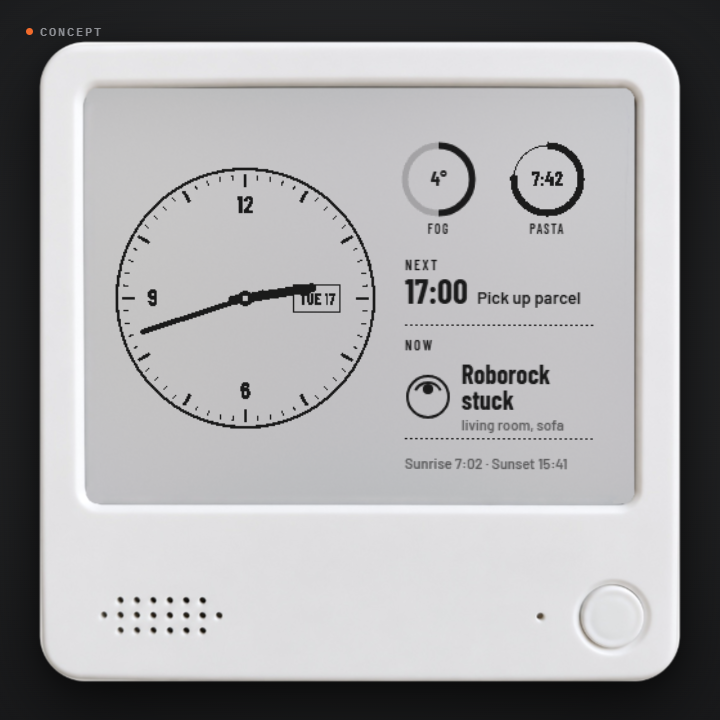<br><b><code>dial</code></b><br><sub>An analogue watch face with sub-dials.</sub></td>
<td width="25%" align="center">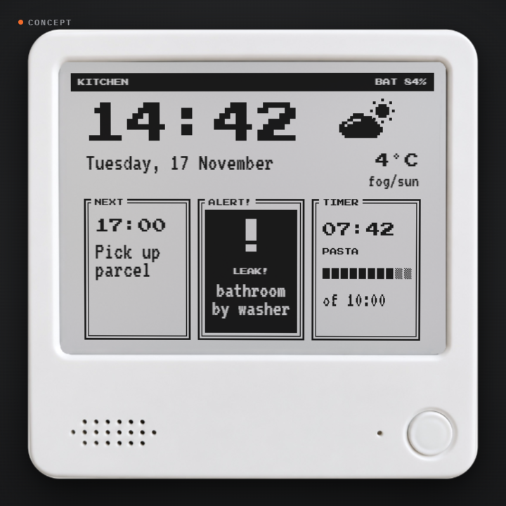<br><b><code>pixel</code></b><br><sub>Pixel fonts and windows, a retro handheld.</sub></td>
<td width="25%" align="center">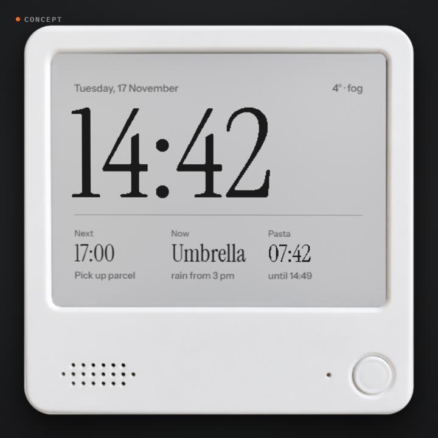<br><b><code>quiet</code></b><br><sub>Almost empty: one big thing, the rest a whisper.</sub></td>
</tr>
</table>

## Six languages

<div align="center">
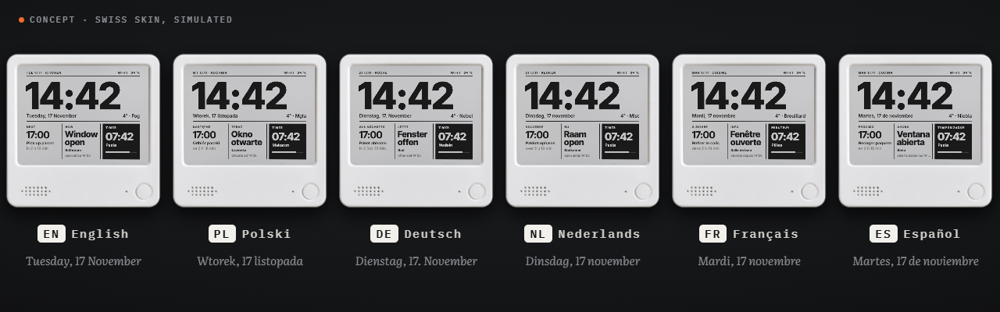
</div>

Everything the panel draws is English by default. Set `language:` in the thin
config's `substitutions:` for another one:

```yaml
substitutions:
  language: de    # en (default), pl, de, nl, fr, es
```

| Code | Language | |
|---|---|---|
| `en` | English | default |
| `pl` | Polish | native |
| `de` | German | review by native speakers welcome |
| `nl` | Dutch | review by native speakers welcome |
| `fr` | French | review by native speakers welcome |
| `es` | Spanish | review by native speakers welcome |

The German, Dutch, French and Spanish tables were written without a native
speaker. If a word reads wrong or a better short form exists, a pull request
against [components/note4_ui/strings.cpp](components/note4_ui/strings.cpp) is
the fix.

<details>
<summary>What the language setting covers</summary>

<br>

Only the on-screen text: labels, weekday and month names, weather words, hints.
Home Assistant entity names stay English, and what the assistant hears and says
is the language of the Assist pipeline you pick in Home Assistant. Text you push
with the actions (event titles, the "Now" card, the forecast summary) is shown as
sent, so send it in the same language; the blueprints take the same language
codes. A new language is one more table in
[components/note4_ui/strings.cpp](components/note4_ui/strings.cpp). Latin
scripts only for now: some skin fonts have no Cyrillic or Greek, and CJK fonts do
not fit in flash.

</details>

## What it does

- **Voice assistant.** On-device wake word (`alexa`, `okay nabu`, `hey jarvis`,
  picked in Home Assistant) via `micro_wake_word`, the full Assist pipeline, and
  "Stop" on its own to silence an alarm or cut a reply short.
- **Full duplex.** Through
  [esp_audio_stack](https://github.com/MichalZaniewicz/esphome-audio-stack) and
  esp_aec, with the ES8311's own DAC feedback as the echo reference, so the wake
  word is designed to work while the device is talking (barge-in).
- **An e-paper interface.** Listening (live waveform), thinking (the heard
  question and each step), answering (typed word by word), the page of the day,
  tomorrow's forecast and a running timer. Partial refreshes
  wherever the layout allows, so the clock and the typing do not flash the panel.
- **The page of the day.** Clock, weather, today's timeline, what's next, a
  running timer and the "Now" card, kept current by Home Assistant.
- **Voice timers** with an alarm that always rings on the device.
- **Replies on another speaker** if the room has one (`TTS output` select).
- **Buttons.** OK talks (or stops whatever is going on), a 2 s hold silences the
  alarm; UP/DOWN step through the page of the day, forecast and timer; DOWN is
  the power key (hold 3 s to switch off on battery).
- **Battery.** Voltage, percentage, charging state, and an RTC that keeps the
  clock right before Wi-Fi is up.

## Home Assistant blueprints

The device only draws; these blueprints feed it. Import them, then create one
automation from each you want. They write their texts in any of the six screen
languages and can run as often as they like: the device ignores a resend that
changes nothing, so the e-paper only refreshes when the content does.

| Blueprint | What it sends | |
|---|---|---|
| ["Now" card](blueprints/automation/note4_now_card.yaml) | The one thing that matters: an alarm (smoke, gas, CO, leak), then a window open too long, a weather warning, a vacuum in error, a plant with a problem or a recent event, else a one-sentence day brief written by AI Task every morning. | [](https://my.home-assistant.io/redirect/blueprint_import/?blueprint_url=https%3A%2F%2Fgithub.com%2FMichalZaniewicz%2Fesphome-zectrix-note4-va%2Fblob%2Fmain%2Fblueprints%2Fautomation%2Fnote4_now_card.yaml) |
| [Tomorrow's forecast](blueprints/automation/note4_forecast.yaml) | Hourly temperature and rain for 6:00-24:00 tomorrow, high/low, when rain starts, wind, humidity, sunrise and sunset, from any weather entity with hourly and daily forecasts. | [](https://my.home-assistant.io/redirect/blueprint_import/?blueprint_url=https%3A%2F%2Fgithub.com%2FMichalZaniewicz%2Fesphome-zectrix-note4-va%2Fblob%2Fmain%2Fblueprints%2Fautomation%2Fnote4_forecast.yaml) |
| [Today's events](blueprints/automation/note4_calendar.yaml) | The day timeline and the "next" line from one or more calendars. | [](https://my.home-assistant.io/redirect/blueprint_import/?blueprint_url=https%3A%2F%2Fgithub.com%2FMichalZaniewicz%2Fesphome-zectrix-note4-va%2Fblob%2Fmain%2Fblueprints%2Fautomation%2Fnote4_calendar.yaml) |

Every blueprint asks for the **device name**: the ESPHome `name` with dashes
turned into underscores (`note4-va` becomes `note4_va`), which is how Home
Assistant names the device's actions.

## Quick start

> [!IMPORTANT]
> Not yet: this is the planned install for when the firmware has been confirmed
> on a device. Requires **ESPHome 2026.7.0+**.

1. Copy `secrets.example.yaml` to `secrets.yaml` and fill in your Wi-Fi.
2. Copy **`note4-va.yaml`** next to it and edit the `substitutions:` at the top
   (name, skin, room, language, weather entity, timezone). Delete the skin lines
   you will never use: each one costs flash and build time.
3. First flash over USB, then updates go wireless:
   ```
   esphome run note4-va.yaml
   ```
4. In Home Assistant the new ESPHome device appears; open **Configure** and
   assign an Assist pipeline.
5. Say "Alexa", or press OK.

After changing anything in the core, run `esphome clean` before the next build,
otherwise ESPHome reuses the cached copy of the remote package.

## Roadmap

- [x] E-paper driver ported from Zectrix's reference (full 1-bit, partial 1-bit, full 16-grey), on its own task
- [x] Voice side ported from the [Box-3 project](https://github.com/MichalZaniewicz/esphome-esp32-s3-box-3-va): wake word, echo cancellation, timers, "Stop"
- [x] Eight skins, six screen languages
- [x] Three Home Assistant blueprints
- [x] Compiles in CI with every skin and language
- [ ] The device arrives; full flash backup
- [ ] Bring-up: power latch on battery, speaker and microphone, echo-cancellation reference, refresh timings ([checklist](docs/HARDWARE.md#bring-up-checklist))
- [ ] Skins tuned on the real panel (raster, ghosting, contrast)
- [ ] Battery life measured
- [ ] First release

## Reference

<details>
<summary><b>Home Assistant actions</b></summary>

<br>

Home Assistant pushes what the page of the day shows. The actions appear as
`esphome.<name>_<action>`, e.g. `esphome.note4_va_set_now`.

| Action | Variables | What it does |
|---|---|---|
| `set_now` | `level` int (0 brief, 1 to do, 2 alarm), `title`, `body`, `detail`, `icon` | The "Now" card: what matters right now. Level 2 is drawn in negative and brings the page of the day up. Icons: `window`, `wind`, `plant`, `vacuum`, `school`, `flood`, `smoke`, `brief` |
| `set_forecast` | `day`, `date`, `hi` float, `lo` float, `summary`, `detail`, `temps` float[19], `rain` float[19], `rain_start` float, `wind`, `humidity`, `sunrise`, `sunset` | Tomorrow's forecast. `temps` / `rain` (mm) are hourly for 6:00-24:00; `rain_start` is an hour (15.5 = 15:30), negative for none |
| `set_events` | `starts` float[], `ends` float[], `titles` string[], `next_time`, `next_title`, `next_in` | Today's timeline (hours as floats) and the "next" line |
| `show_screen` | `name`: `idle`, `weather`, `timer` | Switch screen. Ignored during a conversation |

```yaml
action: esphome.note4_va_set_now
data:
  level: 1
  title: "Window open"
  body: "Bathroom · 12 min"
  detail: "heating paused"
  icon: window
```


Weather now comes from `weather_entity` on its own (its state and its
`temperature` attribute); today's high/low from the optional
`weather_high_entity` / `weather_low_entity` sensors.

</details>

<details>
<summary><b>Grey or black and white</b></summary>

<br>

The panel can draw 16 greys, but only on a full refresh, which takes about 7 s;
partial refreshes are 1-bit. So screens with something live on them (the clock,
a countdown, the typing) run 1-bit with a Bayer raster for their tones, and the
**16 greys** switch lets the static forecast screen use real greys.
[docs/HARDWARE.md](docs/HARDWARE.md) has the details and the timings measured by
other NOTE4 projects.

</details>

<details>
<summary><b>Repository layout</b></summary>

<br>

```
note4-va.yaml            # YOUR config: copy + edit this (pulls the rest from GitHub)
secrets.example.yaml     # copy to secrets.yaml
base/
  core.yaml              # the always-on core, pulled as a remote package
  skins/<name>.yaml      # one package per skin (fonts + registration)
  sounds/                # wake beep, boot chime, timer alarm
components/
  zectrix_epd/           # e-paper display driver (SSD2683, ported from Zectrix)
  note4_ui/              # UI model, refresh policy, skins, string tables
blueprints/automation/   # the three Home Assistant blueprints
ci/local.yaml            # validates/compiles the working tree (CI uses this)
docs/HARDWARE.md         # pin map, power latch, battery, refresh limits, bring-up
```

</details>

## Credits

The e-paper panel driver is ported from Zectrix's ESP-IDF `zectrix_epd`
component (MIT, see `components/zectrix_epd/LICENSE-zectrix-epd`). Audio:
[n-IA-hane/esphome-audio-stack](https://github.com/n-IA-hane/esphome-audio-stack).
The timer sound is Home Assistant Voice PE's. Device photo: Zectrix; the screens
on it are simulated. Hardware notes owe a lot to the NOTE4 community firmware
projects listed in [docs/HARDWARE.md](docs/HARDWARE.md).

## License

MIT, see [LICENSE](LICENSE).
